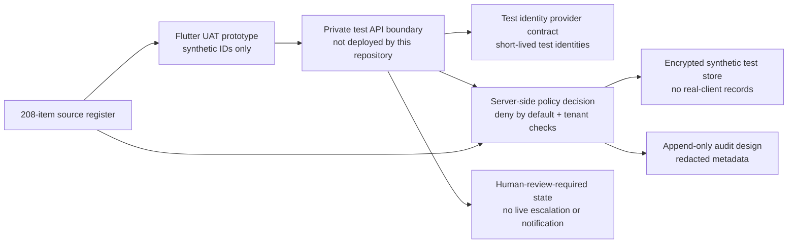

# STN non-production backend architecture — design/test only

**Status:** Design and executable control-contract test only.  
**Environment:** Private engineering branch; synthetic fixtures only.  
**Not provided:** A deployed API, identity provider, database, credential, cloud account, patient record service, clinical workflow, public endpoint, or production release.

## Purpose and hard boundary

This design supplies a reviewable target architecture for a future backend without connecting the Flutter prototype to a live service. It cannot accept real-client data and must not be used for clinical care, diagnosis, triage, risk clearance, notification, referral, or clinical record keeping.

The machine-checkable requirements are in `nonproduction-backend/control-contract.json` and are checked by `tests/nonproduction-backend-controls.test.js`. The source-content boundary is enforced by `tests/paper-pilot-item-traceability.test.js`.

## Proposed non-production test topology

No arrow in this diagram represents an active integration. It describes the required isolation and control points for a future synthetic test harness only.

## Control requirements

| Area | Non-production design requirement | Current implementation status |
|---|---|---|
| Authentication | Test identity-provider integration contract; short-lived synthetic test identities; no shared credentials | Contract only; no identity provider or tokens |
| Authorization | Server-side, deny-by-default decisions; tenant isolation; least-privilege roles | Contract only; no API |
| Audit | Append-only event design with tamper-evident chaining; redacted metadata; auditor-only access | Contract only; no audit store |
| Encryption | TLS 1.2+ for any future test endpoint; encrypted persistence/backups; environment-managed test keys outside source control | Requirement only; no deployed datastore |
| Privacy | Synthetic-only inputs; redacted logs; analytics disabled; no residency/retention decision implied | Contract checked |
| Safety | Human-review-required state only; no automatic diagnosis, triage, routing, notification, or escalation | Contract checked; no operational workflow |
| Source scope | 25 existing Part A Flutter mappings only; remaining 183 source items explicitly not implemented | Item register and regression test |

## Test-only roles and permissions

| Role | Allowed synthetic actions | Explicitly denied |
|---|---|---|
| `uat_admin` | Manage synthetic tenants/testers; inspect audit metadata | Read any real-client data; bypass audit |
| `synthetic_assessor` | Create/read/update own synthetic draft | Cross-tenant reads; clinical decision functions |
| `synthetic_reviewer` | Read assigned synthetic draft; record non-clinical review note | Live referral, notification, escalation or handover |
| `auditor` | Read redacted audit metadata | Assessment-response payloads, credentials, routine clinical work |

A future implementation must enforce these authorizations on the server, for every request, from the authenticated principal and tenant context. Client-side visibility alone is not authorization.

## Required audit event shape

A future event store must persist the following metadata fields at minimum:

- `event_id`
- `occurred_at_utc`
- `actor_id` and `actor_role`
- `tenant_id`
- `action`, `resource_type`, and `resource_id`
- `decision` and `correlation_id`
- `previous_event_hash`

Routine audit metadata must not contain response text/values, free-text notes, identifiers, tokens, secrets, or credentials. Retention, legal hold, access/correction, export, deletion, and breach-response processes are out of scope until privacy and records governance are approved.

## Safety and clinical limits

A source safety tag can only result in a **synthetic human-review-required state** in the future test harness. It must not be converted into a score, safety tier, diagnosis, risk disposition, automatic route, clinician assignment, live alert, or escalation. A real service needs a clinically approved protocol with accountable responders, acknowledgement, timeout/fallback, after-hours cover, exercises, and signed release evidence.

The 208-item paper-pilot register is a development traceability reference, not clinical approval. The register carries exact source locations and content in [the traceability JSON](../../reference/traceability/STN-INITIAL-1.0.0-item-traceability.json); it maps only the 25 existing Part A items to Flutter. It does not reproduce or authorize the remaining 183 items in the app.

## Promotion is blocked until all gates close

The following are required before any production implementation or deployment can be considered:

1. Exact-version clinical approval, intended-use definition, clinical safety case, and independent validation.
2. Written digital-use/reproduction/scoring/reporting rights for every instrument.
3. Privacy impact assessment, data-flow/hosting decisions, health-record governance, retention/disposal, and incident response.
4. A real identity provider with MFA, server-side authorization, tenant isolation, key management, append-only audit persistence, encryption, backup/restore, monitoring, and security testing.
5. Approved human safety operations, ownership, acknowledgement, escalation/fallback, and drill evidence.
6. A signed go/no-go against a precise commit, environment, and artifact hash.

Passing the two repository tests confirms only that this **design contract** remains synthetic-only and non-production. It is not evidence that the controls operate in a deployed system or that STN is clinically approved.
